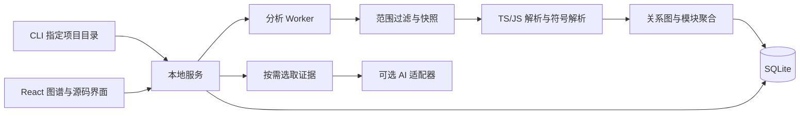

# CodeTrail 首版 MVP 需求与技术方案

版本：0.1 草案 · 日期：2026 年 11 月 5 日

## 1. 产品定位与首版目标

帮助开发者在 vibe coding 过程中理解项目架构、找到关键代码，并判断代码修改的潜在影响。新手可以循序理解项目，熟练开发者可以快速定位并核实判断。

首版验证一个完整闭环：**导入本地项目 → 看懂架构 → 找到关键代码 → 追踪局部调用链 → 查看修改影响 → 返回源码核实。**

产品价值以用户完成理解任务的速度与正确率衡量。图谱是理解代码的交互方式；节点数量和图形复杂度不作为成功指标。

当前项目为空目录。本方案为待实施的产品与技术设计，技术选型、规模和工期均属于首版假设，不代表已有能力或实测结果。

## 2. 首版假设与适用范围

- 使用方式：本地 CLI 启动服务，浏览器打开界面。通过 CLI 传入项目目录；浏览器不承担读取任意本地目录的能力。
- 用户场景：个人开发者分析自己正在开发的单个项目，中文说明优先，保留原始代码名称。
- 验收平台：先以 Windows 为主；核心分析逻辑保持跨平台，其他平台的安装体验后续验证。
- 分析语言：`.ts`、`.tsx`、`.js`、`.jsx`，优先支持 ESM、常规 TypeScript 配置及 React 项目。
- 项目边界：一个本地仓库、一个主要包或用户明确选定的子项目。复杂 monorepo、项目引用链和跨仓库关系后续扩展。
- 首批适配对象：React + Vite 应用，以及常规 TypeScript 模块项目。Next.js 等框架的路由、服务端与客户端边界暂不做专门适配。
- 规模目标：不超过 500 个纳入分析的源码文件、约 5 万行源码。超过范围先提示缩小目录；这不是性能承诺。
- 不依赖运行项目；不自动安装目标项目依赖。缺少依赖时保留可解析结果，并报告解析缺口。
- AI 为可选解释能力。不开启 AI 时，仍可使用目录、符号、依赖、源码定位和改动影响功能。

选择 TS/JS 是为了先把一种生态下的符号解析与证据链做扎实。后续通过分析器接口加入其他语言。

## 3. 用户任务与阅读深度

### 3.1 新手任务

用户接手 AI 生成的 React 项目，希望知道入口在哪里、组件如何组织、点击按钮以后执行了什么。

默认先展示模块职责、入口候选、推荐阅读顺序和术语解释。每个模块提供简短中文说明，进一步展开后再展示文件、函数和引用关系。代码事实附源码位置，业务职责说明标明推断性质。

验收任务：用户能指出项目入口、描述至少三个主要模块，并从一个事件处理函数找到相关业务函数。

### 3.2 熟练开发者任务

用户准备修改一个公共方法，希望快速查看调用者、跨模块依赖、相关测试，以及当前工作区的修改范围。

提供紧凑视图，优先显示符号名称、签名、路径、直接调用者和影响路径。解释按需展开。

验收任务：用户能定位目标符号、追踪至少一条引用路径，并解释为什么某个模块需要回归验证。

### 3.3 共用同一套证据

“引导阅读”和“紧凑阅读”只改变信息呈现密度。事实、关系和分析边界保持一致，用户可随时切换，不要求注册时选择新手或老手身份。

## 4. 首版功能范围

P0 为首版发布必需；P1 在核心闭环通过验收后再安排。

### P0-01 本地项目导入与分析状态

- 通过类似 `codetrail open <项目目录>` 的 CLI 命令启动。命令形式为产品设计，尚未实现。
- 显示项目名称、根目录、文件范围、忽略规则及是否存在 Git 基线。
- 默认排除 `.git`、`node_modules`、构建产物、二进制文件、密钥文件；合并 `.gitignore` 和工具自身忽略配置。排除规则先于内容解析生效。
- 分阶段显示扫描、语法解析、关系解析、生成图谱状态；允许取消和重试。
- 结束时显示成功解析、失败、跳过和不支持的文件数，以及未解析引用数量。不能把部分成功显示成完全分析。

验收：中文和带空格路径可导入；单文件语法错误不阻断其余文件；无 Git 仓库也能查看架构与代码关系。

### P0-02 架构概览与逐层展开

- 初始视图展示按一级源码目录或用户选定目录聚合的模块，目标控制在 8～20 个节点。
- 支持模块 → 文件 → 符号的逐层进入、面包屑返回、搜索定位、聚焦与邻居展开。
- 模块卡片展示路径、文件数、外部依赖、入口候选和职责说明。
- 目录聚合属于结构组织方式；识别出的业务模块属于推断，用户可修改显示名称与描述。
- 图与列表提供等价导航；避免只依靠拖动画布或颜色理解关系。

验收：从架构视图进入任意已索引文件；点击关系后能查看支撑这条关系的代码位置；循环依赖可以展示。

### P0-03 关键代码与推荐阅读顺序

- 输出少量关键代码候选，默认不超过 10 项，并解释推荐原因。
- 原因来自可计算线索：入口候选、被多少不同文件引用、是否连接多个模块、是否承担公共接口。
- 提供入口、业务相关模块、公共基础代码三类阅读入口，避免高引用工具函数占据全部推荐位置。
- 用户可标记关注的模块或符号，形成阅读清单；本地保存，不改写源码。

验收：每条“关键”推荐都能展开具体原因和引用证据。只能说明结构上的重要性线索，业务重要性需要用户确认。

### P0-04 局部调用与使用关系

- 用户通过文件名、符号名、路径搜索，或选择入口候选，进入局部关系视图。
- 展示直接调用者、被调用者、符号引用及组件使用关系；不同关系使用明确文字标签。
- 默认展开一层，可继续展开，单次结果限制为 100 个节点；提示隐藏数量及截断原因。
- 将 `CALLS`、`REFERENCES`、`RENDERS`、回调注册候选区分呈现。把函数作为参数传入，不等同于已证明该函数被执行。
- 支持函数、箭头函数、常规方法、静态导入与导出；能解析到的 JSX 组件使用另记关系。
- 动态分发、反射、运行时注册和无法解析的调用保留未解析状态。

验收：在包含同名函数、别名导入、转导出及循环依赖的样例中，能正确定位已支持的关系。界面明确说明这是静态关系，不能当作实际执行顺序或完整业务流程。

### P0-05 带证据的代码解释

- 节点提供“解释这段代码”“为什么值得关注”“上下游是什么”三个固定动作，控制首版问答范围。
- 简明说明先展示职责与主要步骤，详情展示签名、关系、代码片段和分析限制。
- 开启 AI 后，按需发送当前问题需要的代码片段与图关系；展示待发送文件范围，并允许关闭。
- 解释中的代码事实必须关联有效证据；业务解释与阅读建议明确标为推断。
- 模型不可用、超时或用户未配置时，退回结构化事实说明，保留其他功能。

验收：每个引用可定位至对应分析快照的文件行号；不存在的证据 ID 被拒绝；模型无法确定时显示信息不足。引用存在只证明可追溯，不代表语义已自动验证。

### P0-06 当前改动的潜在影响

- 首版只提供一个明确比较口径：当前 `HEAD` 与工作区当前文件内容，包含已暂存和未暂存修改；纳入范围的未跟踪文件单独列为新增。
- 展示新增、修改、删除、重命名候选文件及命中的符号，给出直接和默认最多两跳的间接关联对象。
- 区分运行时调用、组件使用、一般符号引用和纯类型依赖的传播方式，避免混为一种影响。
- 为每个潜在影响对象提供“修改位置 → 引用或调用关系 → 关联对象”的路径。
- 删除与断开的调用关系使用旧快照分析；新增关系使用新快照。不能只分析修改后的代码。
- 相关测试来自测试文件对符号或文件的静态引用；根据命名猜测的测试另标候选，不宣称覆盖率。
- 新仓库没有提交时，显示当前文件和新增清单，提示缺少比较基线；暂不生成完整历史影响结论。

验收：公共函数删除、导出签名修改、文件重命名及纯类型修改都有明确结果或降级说明。结果用“潜在影响”和“建议验证”表述，不宣称发现了实际故障，也不能承诺未列出的地方不受影响。

### P0-07 证据、源码与快照状态

- 侧栏展示只读源码、行号、关系所在代码及证据来源，可复制路径与行号。
- 全局显示分析版本、完成时间和当前是否过期。检测到文件变化后提示刷新；首版以手动刷新为主。
- 旧快照中的行号定位到旧内容；若当前文件已变更，明确提示位置可能变化。
- 首版使用内置只读源码视图，不强依赖任何特定编辑器。

### P1 与后续范围

- P1：自由问答、自动刷新、编辑器跳转、导出阅读报告、更多框架入口识别。
- 后续：Python/Java/Go、复杂 monorepo、前后端跨进程关联、运行时追踪、完整数据流、跨提交浏览、IDE 插件、MCP、多人协作。
- 首版不实现账号与云端代码托管、自动修改代码、自动修复或自动运行测试。

## 5. 核心界面与一次使用流程

界面采用左侧导航、中间图或列表、右侧解释与证据的布局。顶部显示项目、分析状态和刷新入口，主导航为“架构”“阅读清单”“改动影响”。

新手首次进入架构视图时，先看到三个引导动作：找入口、了解主要模块、追踪一个功能。熟练开发者可以直接搜索符号。

以“提交表单”为例，用户先找到组件中的提交处理函数，再查看它引用或调用的校验、请求模块。每一步能打开代码核实。若调用链到达网络请求而仓库中没有可确认的服务端对应关系，链路在此终止并说明边界，不能自动补出数据库写入流程。

AI 修改校验函数后，用户进入改动影响，看到变化的函数、引用它的表单处理函数和相关测试文件，逐条查看关联依据，再决定回归范围。

## 6. 推荐技术架构

采用本地优先的 TypeScript 工程：浏览器前端、本地服务、独立分析 Worker、本地数据存储、可替换的 AI 解释适配器。

### 6.1 前端与图展示

推荐 React + TypeScript + Vite；图交互使用 React Flow，自动布局使用 ELK，源码先使用轻量只读高亮组件。

React Flow 支持父子节点与分组，可承载模块与文件的展开关系；布局需要单独接入算法，并处理循环依赖。首版优先按层切换和局部子图，避免一次渲染完整符号图。[React Flow 分组文档](https://reactflow.dev/learn/layouting/sub-flows)、[布局文档](https://reactflow.dev/learn/layouting/layouting)。

本地筛选、选中状态使用 React 状态即可。暂不引入复杂全局状态框架；服务端通过局部图查询控制数据量。图以外的搜索、路径与列表导航应支持键盘使用。

### 6.2 本地服务与执行隔离

推荐 Node.js LTS + Fastify，通过 HTTP 查询结果、SSE 推送分析进度；解析和布局等 CPU 密集任务在 Worker 中运行。服务只监听回环地址，以会话令牌、来源校验和路径约束保护本地文件接口。

CLI 只传入已选项目，服务只允许访问该根目录范围内已登记的文件。缓存放在工具自己的用户数据目录，并以规范化项目路径隔离。生产启动时本地服务直接提供构建后的静态前端，用户不需要同时启动两个开发服务。

具体包版本在第一阶段兼容性验证后锁定，并记录安装前提。CLI、分析器、前端可采用工作区包组织，但首版部署为一个本地工具。

### 6.3 代码分析器

推荐使用 TypeScript 的 JavaScript 版 Compiler API 获取 AST、符号、类型与模块解析结果。官方文档提供 TypeChecker 与符号 API，但目前明确其示例适用于 TypeScript 6.0 及以前，并提示 7.1 API 将变化。因此第一阶段固定一个兼容版本，包在 `AnalyzerAdapter` 后面，避免依赖“最新版本必然兼容”的假设。[TypeScript Compiler API 官方说明](https://github.com/microsoft/TypeScript/wiki/Using-the-Compiler-API)。

分析步骤：

1. 扫描允许的文件，读取配置，生成内容哈希和分析清单。
2. 创建编译分析上下文，读取语法与解析诊断；不执行项目脚本。
3. 提取声明、作用域、导入导出、符号引用、调用位置与 JSX 组件使用。
4. 使用符号解析连接目标，保留调用现场、候选目标和解析方式；无法唯一确定目标时保持候选或未解析。
5. 将目录聚合为模块，计算结构重要性线索与入口候选。
6. 原子发布新快照。分析失败时保留上一份完整结果。

支持 TS `paths` 等可解析配置；仅在 Vite 运行时配置中定义的别名不承诺自动识别，因为首版不执行配置脚本。允许用户提供额外别名映射。CommonJS、插件转换和跨包配置暂按部分支持或未支持报告。

区分 TSX 组件声明、JSX 使用与 React 实际渲染生命周期；记录 `<Component />` 的静态使用关系，不推断所有运行时分支。

### 6.4 存储与图查询

推荐 SQLite 保存项目、快照、文件、符号、关系、证据及解释缓存。正反向邻接表负责默认的一至两跳遍历；较深查询可使用受限递归查询。SQLite 官方支持树与图的递归查询，这为首版提供了可行基础；实际性能需要在目标规模上验证。[SQLite WITH 文档](https://sqlite.org/lang_with.html)。

选择本地关系表和邻接查询，可减少首版安装与运维成本。暂不引入专用图数据库或向量数据库。搜索先采用路径、符号名和文本匹配；语义搜索待检索任务与效果明确后再加入。

## 7. 图模型与证据模型

### 7.1 核心实体

- `Project`：规范化根目录、忽略配置、用户显示配置。
- `Snapshot`：Git 基线、文件清单哈希、分析器版本、配置哈希、状态及诊断。
- `File`：相对路径、语言、内容哈希、解析状态。
- `Symbol`：快照内 ID、所属文件、作用域、名称、种类、签名、起止位置。
- `Edge`：起点、终点、关系类型、来源类别、解析方式和证据 ID。
- `Evidence`：快照、文件哈希、起止行列、提取器、原始代码片段引用。
- `Explanation`：解释类型、正文、引用证据、模型配置摘要与缓存键。

符号 ID 在快照内稳定；跨快照匹配另外记录，不保证只靠行号稳定。普通修改可用文件路径、限定作用域、名称和声明特征匹配。重命名或复杂移动匹配不确定时，按删除与新增呈现，避免错误合并。

### 7.2 关系类型与方向

- `CONTAINS`：模块到文件，文件或作用域到符号。
- `IMPORTS`：导入方文件到被导入文件，另记类型导入或运行时导入。
- `CALLS`：调用方符号到静态解析目标，证据指向调用表达式。
- `REFERENCES`：使用方到被引用符号，附引用用途及位置。
- `RENDERS`：组件或文件到 JSX 中使用的组件，表达静态使用。
- `REGISTERS_CALLBACK`：由规则识别的回调注册候选，不能当作直接调用。

影响分析沿依赖边反向寻找使用方。例如 A 调用 B，修改 B 后，A 属于潜在关联对象；A 调用的所有其他函数不因此自动成为“受影响”。使用白名单决定哪些边参与某类传播，排除容器关系，并执行深度、数量和去重限制。

### 7.3 三类来源标签

- **静态解析**：语法、模块与符号解析支持的关系；表示代码中可定位的关系，不保证运行时一定发生。
- **规则候选**：入口、模块边界、回调与测试关联等规则识别结果；展示规则与匹配位置。
- **AI 推断**：业务职责、阅读建议、潜在业务影响；与结构事实分开保存和显示。

不展示未经校准的“准确率 95%”或置信百分比。每条关系给出来源与限制，比单一置信分数更可核实。

## 8. 关键代码推荐与解释生成

### 8.1 结构重要性

首版使用可解释排序：不同引用文件数、跨模块连接数、公共导出、入口候选四类信号。将原始数值与排名原因一并返回，按入口、业务模块和公共代码分组展示。

测试、第三方声明与生成文件不参与核心业务推荐。业务文件与工具文件的分类属于候选，允许用户调整。排序权重由试用结果校准，暂不输出难以解释的综合“业务关键度”。

### 8.2 AI 解释流程

1. 从当前节点和问题出发，选择声明、局部关系、引用位置与必要注释。
2. 仅补充与问题相关的项目配置和用户认可的模块说明。
3. 在预算内生成证据包，要求结构化返回“简明说明、细节、证据 ID、不确定项”。
4. 校验证据 ID、位置与快照是否有效；对无有效证据的事实性结论降级或不展示。
5. 用户可打开引用核实，反馈解释有误。

缓存键包含文件与依赖证据哈希、分析版本、提示模板、模型标识、语言和阅读深度；代码或上下文变化后使旧解释过期。设置单次上下文上限、生成上限、并发上限与取消机制；具体 token 预算在选定模型后验证。

源码和注释始终作为待分析数据，不能改变工具权限或触发命令。AI 仅返回解释，不能直接写入解析关系图。首版提供一个模型供应商适配实现与统一接口，不同时开发多个协议。

## 9. 改动分析与刷新一致性

Git 差异用于识别变更文件与代码区间，旧、新代码分别映射到各自符号。Git 官方区分工作区、暂存区与提交间的比较方式；实现需明确使用 `HEAD` 到当前工作区的口径，未跟踪文件另取清单。[Git diff 文档](https://git-scm.com/docs/git-diff)。

首版处理流程：

1. 固定基线提交 ID，读取当前纳入范围的文件哈希和差异信息。
2. 首次建立基线图和工作区图；按需读取 Git 中的旧文件内容，不切换用户分支，不暂存用户文件。
3. 以差异区间命中旧、新符号；符号匹配不确定时退回文件级说明。
4. 结合旧图的删除关系与新图的新增关系，计算有路径证据的直接及受限间接关联。
5. 发布前核对文件清单和哈希；若扫描过程中又有修改，标为过期并允许重新分析，不混用两份代码位置。

先保证全量重建正确，再做增量优化。增量更新不仅重新解析改动文件，还要重新解析受导出、配置和模块解析变化影响的文件；不能仅替换改动文件的边就宣称图谱完整。

## 10. 接口边界与工程组织

以下为设计接口，不代表当前已实现：

- `POST /api/analyses`：对已由 CLI 授权的项目创建或刷新分析任务，返回任务 ID。
- `GET /api/analyses/:id/events`：SSE 进度和诊断事件。
- `GET /api/snapshots/:id/overview`：模块概览、关键候选和分析范围。
- `GET /api/snapshots/:id/search?q=...`：文件与符号搜索。
- `GET /api/snapshots/:id/graph?focus=...&depth=...`：受限局部图。
- `GET /api/snapshots/:id/evidence/:evidenceId`：只读源码与证据。
- `POST /api/snapshots/:id/explanations`：按需解释，返回来源、引用与不确定项。
- `GET /api/comparisons/:id/impact`：基于旧、新快照的影响结果。

建议源码目录：`apps/web` 放界面，`apps/local` 放 CLI 与本地服务，`packages/analyzer` 放解析适配与关系提取，`packages/graph` 放图查询与影响分析，`packages/shared` 放数据契约，`fixtures` 放经过许可的验收样例。以共享 Schema 校验跨层数据，避免前后端对关系含义各自解释。

## 11. 本地代码与 AI 数据边界

- 默认只在本地读取代码，AI 默认关闭；用户配置并开启后，才按需发送选定上下文。
- 密钥由本地服务读取或保存在系统凭据设施中，不写入仓库、不发到浏览器、不进入日志。
- 不自动运行目标项目的脚本、插件或可执行配置；依赖缺失先报告，不自动安装。
- 对文件路径进行规范化及真实路径校验，默认不跟随根目录之外的符号链接。允许的声明依赖与只读配置目录需要单独记录读取策略，不能任意扩大可浏览源码范围。
- Git 命令使用参数数组，禁用外部 diff 与 textconv；仅读取清单、差异与历史内容，不操作用户工作区。
- 日志只记录计数、耗时和错误类别，默认不记录源码、完整提示与密钥。分析缓存和解释缓存提供清除入口。

这些约束直接服务于“分析自己的本地项目”这一使用方式，不增加首版账号或权限系统。

## 12. 验收标准与验证方法

以下为首版发布目标，均需通过实现后的验证，不作为当前实测结论。

### 12.1 功能与证据

- 六步核心闭环可在至少三个小型代表项目中完成：React TSX 应用、TS 模块项目、包含别名与删除场景的 Git 项目。
- 固定人工标注样例覆盖同名函数、作用域、别名、转导出、循环依赖、纯类型导入、回调、动态调用和缺失依赖。
- 对已支持的静态关系，目标精确率至少 95%、召回率至少 85%；分别按关系类型报告，分母和未解析数量可查，不把不支持场景从报告中隐藏。
- 显示的每条关系均有有效证据位置；删除文件能查看旧快照证据；图谱过期可见。
- 通过有意设置的删除、重命名、导出修改与测试引用案例核实影响路径；对于两跳截断与未解析边明确说明遗漏范围。
- AI 使用固定小样本检查事实支持、业务推断标记及错误引用。有效引用率与语义支持率分别统计。

### 12.2 性能与失败处理

- 在记录 CPU、内存、系统、文件数与代码行数的固定机器上，对目标规模做重复测试，报告冷启动与缓存场景。
- 初始目标：排除 AI 时间，首次分析 60 秒内；已有快照的搜索及一至两跳查询 p95 1 秒内；默认局部图 100 节点内保持可操作。
- 以上预算需在第一阶段小样本实测后调整；全量基线与工作区双图分析耗时单独报告。
- 大文件、无 Git、无提交、AI 断网、语法错误、缺失依赖及任务取消都具备可理解的降级行为，不出现永久转圈或伪造完成状态。

### 12.3 用户价值

邀请至少 3 位新手和 3 位熟练开发者，用规模相近的陌生项目完成找入口、描述模块、追踪关系、判断修改关联四类任务。采用交叉顺序，降低先做任务带来的学习偏差。

记录任务耗时、回答正确性、点击证据次数和无法完成原因。首轮目标是中位耗时比直接阅读代码减少约 30%，且理解正确性不下降。样本用于发现问题，不作为统计显著性结论；若价值未出现，优先调整导航与解释，再增加功能。

## 13. 实施顺序与交付物

按一名熟悉 TS/React 的全职开发者估算，约 20～25 个工作日；学习、兼容问题和试用反馈可能延长。以阶段验收推进。

### 阶段一 技术可行性与契约 约 3～4 天

选定并锁定 Compiler API 兼容版本，打通两个小样例的符号与引用提取，验证 JS/TSX、路径别名、回调与未解析场景；定稿图模型与证据契约，记录初步耗时。

交付：解析原型、兼容范围、带源码位置的关系 JSON、人工标注样例。若符号精度达不到目标，先缩小支持范围，暂停扩展图形效果。

### 阶段二 本地导入与架构导航 约 5～6 天

完成 CLI、本地服务、Worker、SQLite 快照、目录与模块聚合、搜索、图与列表导航、源码侧栏和分析诊断。

交付：不开启 AI 也能导入并浏览真实项目的版本。

### 阶段三 关键代码与解释 约 4～5 天

完成推荐原因、阅读清单、局部关系展开、两种阅读密度，以及按需 AI 解释、引用校验和无模型降级。

交付：用户能从概览走到一个具体函数，并理解推荐和关系依据。

### 阶段四 改动影响 约 5～6 天

完成 Git 基线、旧新快照映射、删除与重命名降级、反向影响路径、静态测试关联、过期检测与手动刷新。

交付：当前改动的关联对象、路径、旧新证据及分析边界。

### 阶段五 验收与小规模试用 约 3～4 天

执行关系准确性、失败场景、性能预算及用户任务验证，修复影响闭环的问题，整理安装说明和已知限制。

交付：可本地安装的 MVP、三个演示项目、验收记录、用户反馈及下一版优先级。

## 14. 关键取舍与后续决策

首版最需要守住三件事：关系能够核实、图谱易于导航、改动结果有证据。准确性不足就收窄语言与框架范围；图过于拥挤就减少默认展开；AI 业务解释不可靠就加强事实层与不确定项，而不是让模型补全缺失关系。

开始实施时默认采用本方案的本地形态和 TS/JS 范围。阶段一结束后依据原型结果确认包版本、首版规模与性能预算；AI 供应商选择不阻塞静态分析和界面开发。跨语言、IDE 插件与云端协作等方向，在首轮用户价值验证后再决定。

## 15. 已确认的 Agent 接入阶段（阶段六）

前五阶段完成后，用户确认将主入口调整为 Agent 工作流：本地 MCP 暴露解析、图谱与改动影响，Skill 组织理解项目与改动核实流程，浏览器供开发者查证，CLI 承担底层启动与调试。

实现优先复用现有 AnalysisManager、ComparisonManager、SnapshotStore 和 ProjectExplorer，避免另一套解析事实。每个 MCP 进程固定根目录，使用 stdio，由宿主启动。首个验收宿主选本机可用的 Codex，提供配置生成包和两个可安装 Skill；远程服务、IDE 原生插件、多 Agent 调度和市场发布不纳入本阶段。

六个工具为 project_overview、search_symbols、symbol_context、read_evidence、recommend_reading、compare_worktree。查询使用明确版本 ID，报告过期、截断、未解析和部分分析，沿用旧新快照及同侧路径证据。源码作为不可信数据，不执行目标代码，不让工具自行请求模型解释。结果按字符、行数和图范围设限，错误、取消与超时可恢复。

验收包括真实 stdio 初始化和六类工具链路、旧源码/路径取证、修改后过期与刷新、非法参数/越界/部分解析/无 Git/取消、可选工作台共用快照、Codex 宿主实际发现与调用，以及生产包独立解压后的 MCP 冒烟。模型自主调用与真实用户任务效果单列待验，不把确定性协议验收当作产品效果验证。

使用入口见 [Agent 接入说明](Agent接入说明.md)，工程证据见 [第六阶段验证记录](第六阶段验证记录.md)。
